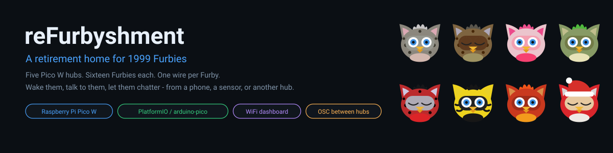
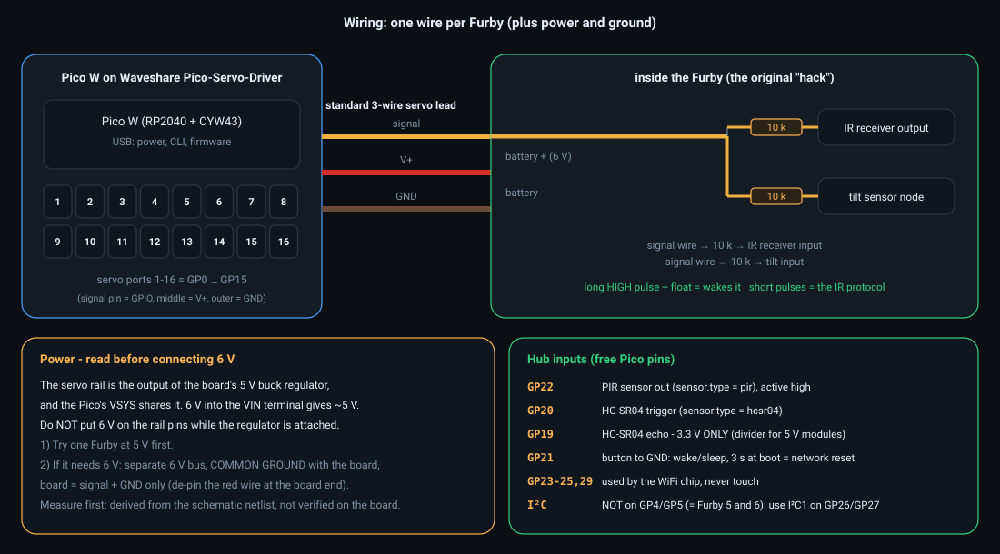
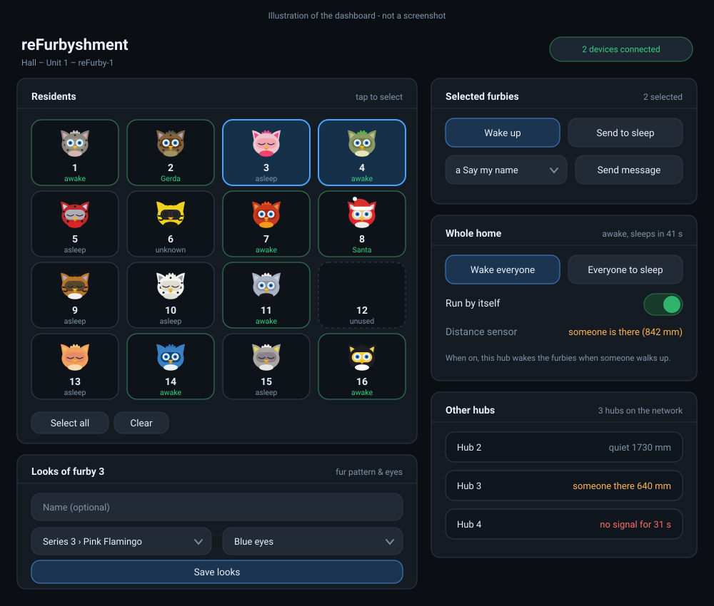
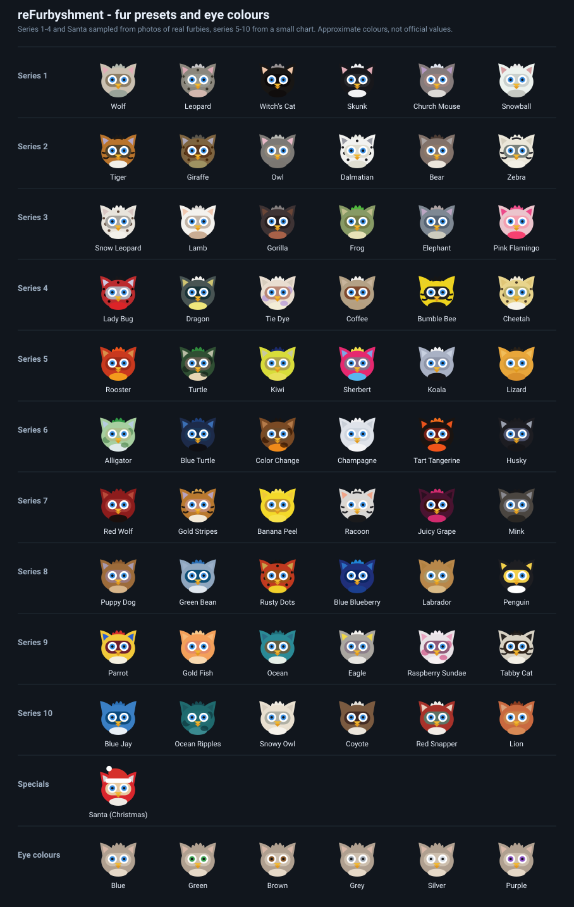
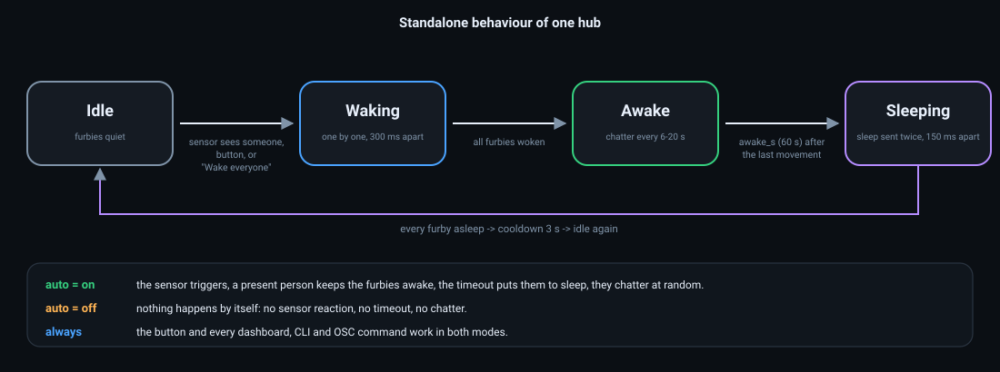
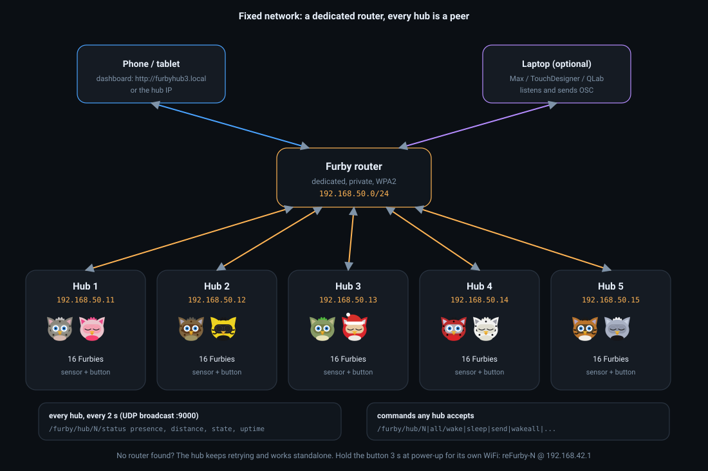
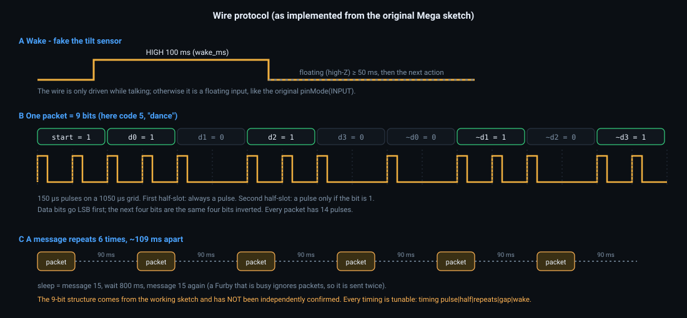
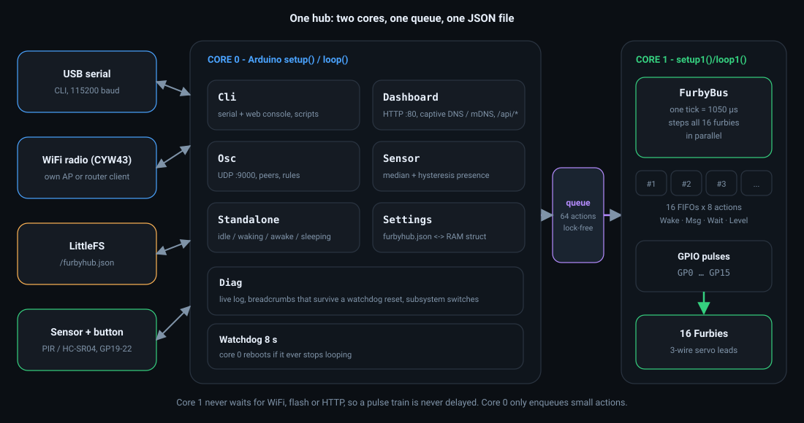

<p align="center"></p>

# reFurbyshment

A distributed controller for a **retirement home for 1998-style Furbies**. Five Raspberry Pi **Pico W** hubs each drive **16 Furbies** over a single wire per Furby, replacing the single Arduino Mega with its central wiring hub. Every hub works on its own (presence sensor or button) and has a phone-friendly web dashboard. Hubs can also talk to each other over OSC on a dedicated router, so one hub noticing a visitor can wake the Furbies on another.

> **Version 0.1.0 - first version, partly bench-tested.** See [Status](#status) for exactly what has and has not been run on hardware. For the technical route and design decisions (the handoff), read **[context.md](context.md)**.

## Contents

[Status](#status) · [Quick start](#quick-start) · [Hardware and wiring](#hardware-and-wiring) · [The dashboard](#the-dashboard) · [Standalone behaviour](#standalone-behaviour) · [Configuration: furbyhub.json](#configuration-furbyhubjson) · [CLI reference](#cli-reference) · [Sensors](#sensors) · [Network and OSC](#network-and-osc) · [Wire protocol](#wire-protocol) · [Architecture](#architecture) · [Troubleshooting](#troubleshooting) · [Tests](#tests) · [Project layout](#project-layout) · [Limitations](#limitations) · [Credits](#credits-and-sources)

## Status

| Area | State | Evidence |
|---|---|---|
| Waking / messaging Furbies from the CLI over the 3.3 V wire | **Works on hardware** | confirmed by the author on a real hub |
| WiFi access point, captive portal, dashboard | **Works on hardware** | confirmed after four bugs were fixed (see context.md) |
| `furbyhub.json`, looks, names, survive a reboot | **Works on hardware** | confirmed by the author |
| Pulse engine timing vs the original Mega sketch | Host-verified | simulation of the real `FurbyBus.cpp` |
| Config layer (JSON, validation, save/recover/migrate) | Host-verified | real `Settings.cpp` + ArduinoJson, in-memory filesystem |
| Presence logic, OSC codec, rule matching | Host-verified | unit tests, OSC spec byte examples |
| PIR / HC-SR04 sensor drivers | **Compiled only** | not run on hardware yet |
| Router (STA) mode, mDNS | **Compiled only** | not run on hardware yet |
| OSC between hubs, rules | **Compiled only** | codec tested on the host; UDP not run on hardware |
| Furby wire protocol structure (9 bits, 4 data + inverse) | Taken from the working sketch | **not independently confirmed** |
| 6 V supply for the Furbies | Open question | analysed from the schematic text only, see [Power](#power) |

## Quick start

1. **Wire one hub** as shown in [Hardware and wiring](#hardware-and-wiring): Pico W on the Waveshare Pico-Servo-Driver, Furbies on the servo ports.
2. **Build and flash** with [PlatformIO](https://platformio.org/) (VS Code):
   ```bash
   pio run                  # build (first run downloads the platform and ArduinoJson)
   pio run -t upload        # flash; hold BOOTSEL while plugging the Pico in the first time
   pio device monitor       # CLI over USB serial, 115200 baud
   ```
   One binary serves all five hubs. The hub number lives in the configuration, not in the firmware.
3. **First boot:** the hub writes a default `/furbyhub.json` to its flash and prints `config: no config found: wrote defaults`. Type `status`.
4. **Give each hub its number**, once: `config set hub.id 3`, `save`, `reboot`. The WiFi name becomes `reFurby-3`.
5. **Open the dashboard:** join WiFi `reFurby-<n>` (password `furbyfurby`), the captive portal opens by itself, or browse to `http://192.168.42.1`.
6. **Test a Furby:** `wake 1`, then `send 1 name`, then `sleep 1`.

> Only the files in `src/` and `include/` belong to the firmware. Everything in `test/` is for your PC. If you copy a file named `Arduino.h` into `include/` it shadows the real framework header and the build fails with hundreds of errors.

## Hardware and wiring

<p align="center"></p>

**Parts per hub**

| Part | Notes |
|---|---|
| Raspberry Pi **Pico W** | RP2040 + CYW43 WiFi |
| Waveshare **Pico-Servo-Driver** | 16 servo ports; from its schematic the four 4-pin signal headers carry **GP0-GP15** |
| 16 Furbies (1999 line) | each with the signal-wire modification below |
| 16 standard 3-wire servo leads | signal, V+, GND |
| Presence sensor | PIR (GP22) **or** HC-SR04-type ultrasonic (trigger GP20, echo GP19, 3.3 V only) |
| Push button (optional) | GP21 to GND |
| Power for the Furbies | see [Power](#power) |

**The modification inside each Furby** is a single wire in parallel with the tilt sensor and the IR receiver, with a **10 k series resistor to each** of the two inputs. A *long* HIGH pulse followed by a floating line makes the Furby think the tilt sensor was used (wake-up). *Short* pulses carry the original infrared protocol.

Furby number *n* (1-16 everywhere in the UI, CLI and API) is wired to `GP(n-1)`. Check that Furby 1 is really GP0 on your silkscreen with `hold 1 high` and a multimeter; if not, edit `FURBY_PIN[]` in `include/config.h`.

### 3.3 V logic

The Pico drives 3.3 V where the Mega drove 5 V, and the Furby inputs were never designed for either. Bench-test it:

1. With the Furby powered, measure the idle voltage on the signal wire (`hold 1 float`). The RP2040 is **not 5 V tolerant**; the 10 k resistors limit the current, but check.
2. `pulse 1 100` - does it wake? `send 1 name` - does it speak?
3. `sweep 1 20 200 20` wakes Furby 1 and sends *name* at pulse widths from 20 to 200 us. Note which widths work.
4. If 3.3 V is marginal: a 74HCT245 buffer on 5 V between Pico and Furby is the usual fix.

### Power

> **Read before connecting 6 V.** This was derived from the board's schematic text, not measured on the board.

The Waveshare board's servo rail is the output of its on-board **5 V buck regulator**, and the Pico's VSYS shares that rail. A 6 V supply on the board's VIN terminal therefore gives about **5 V** on the servo pins. Do not put 6 V on the rail pins while the regulator and the Pico are attached.

1. Try one Furby at 5 V first. It may be perfectly happy.
2. If it needs 6 V: use a separate 6 V supply and bus with a **common ground** to the board, and use the board for signal and ground only (de-pin the red wire from each servo plug).

Sixteen Furbies on one regulator is also why wake-up is staggered (`standalone.wake_stagger_ms`, default 300 ms).

## The dashboard

<p align="center"></p>

*The picture above is an illustration drawn from the real interface and icon set, not a screenshot.*

- **Residents** - 16 tiles with a drawn face each. Closed eyes mean asleep, open eyes awake, half-open unknown. **Furbies cannot answer over the wire**, so these states are *what the hub last told each Furby*, not a measurement. A small orange dot marks a Furby with queued commands.
- **Selected furbies** - tap tiles, then *Wake up*, *Send to sleep*, or send any of the 16 messages.
- **Whole home** - staggered *Wake everyone* / *Everyone to sleep*, the *Run by itself* switch, the live sensor reading.
- **Other hubs** - appears in router mode: presence and distance reported by the other hubs, and how long ago each was heard.
- **Looks** - select one Furby, then pick a fur pattern, eye colour and an optional name; saved to `furbyhub.json`.
- **Which furbies are connected**, **Configuration** (the whole `furbyhub.json` as editable text) and a **Console** with the same commands as the USB serial CLI.

### Looks

<p align="center"></p>

61 fur presets: series 1-10 of the original line plus the *Santa* Christmas special, and six eye colours. **The colours are approximations, not official values.** Series 1-4 and Santa were sampled from photographs of real Furbies, series 5-10 from a small chart (lower fidelity, some estimated by eye). Presets live in `include/DashboardPage.h` (`PRESETS`).

## Standalone behaviour

<p align="center"></p>

Works with or without any WiFi client. With **auto on**, the sensor wakes everybody (one by one, so sixteen motors do not start together), a person who stays keeps them awake, and `awake_s` after the last movement they are put to sleep. While awake they may chatter at random (messages *name, dance, sneeze, sheep*, never a sleep message). With **auto off** nothing happens by itself. The button and all commands work in both modes. While auto is off the hub never wakes or sleeps anything by itself.

## Configuration: furbyhub.json

Everything lives in one file on the Pico's flash: `/furbyhub.json` on a 0.5 MB LittleFS partition. Three ways to edit it, all through the same code:

| Way | How |
|---|---|
| CLI | `config show`, `config get <path>`, `config set <path> <value>`, then `save` |
| Web | dashboard, *Configuration* (GET/POST `/api/config`), or *Looks* |
| File | upload the file with the PlatformIO LittleFS uploader |

```json
{
  "version": 1,
  "hub":        { "id": 1, "name": "Hall", "auto": true },
  "network":    { "mode": "sta", "ssid": "furbynet", "pass": "********", "ap_pass": "********",
                  "ip": "192.168.50.11", "gateway": "192.168.50.1", "mask": "255.255.255.0",
                  "osc_port": 9000, "osc_target": "" },
  "protocol":   { "pulse_us": 150, "half_bit_us": 1050, "repeats": 6, "gap_ms": 90, "wake_ms": 100 },
  "standalone": { "awake_s": 60, "wake_stagger_ms": 300, "sleep_stagger_ms": 150, "chatter": true,
                  "chat_min_s": 6, "chat_max_s": 20, "cooldown_s": 3 },
  "sensor":     { "type": "hcsr04", "wake_mm": 1200, "sleep_mm": 1500, "smooth_ms": 200 },
  "furbies":    { "1": { "enabled": true, "name": "Gerda", "preset": "giraffe", "eyes": "green" } },
  "rules":      [ { "on": "hub/3/presence", "do": "wakeall", "delay_ms": 400 } ]
}
```

| Key | Default | Range / values | Meaning |
|---|---|---|---|
| `hub.id` | 1 | 1-99 | hub number; decides the WiFi name and OSC address |
| `hub.name` | "Hub 1" | text | shown in the dashboard |
| `hub.auto` | true | | standalone behaviour on/off |
| `network.mode` | `ap` | `ap` or `sta` | own access point, or join the router |
| `network.ssid` / `pass` | empty | WPA2, 8+ characters | the router (router mode only) |
| `network.ap_pass` | `furbyfurby` | 8+ characters | password of the hub's own WiFi |
| `network.ip` / `gateway` / `mask` | empty / empty / 255.255.255.0 | IPv4 | static address in router mode; empty `ip` = DHCP |
| `network.osc_port` | 9000 | 1024-65535 | OSC listen and send port |
| `network.osc_target` | empty | IPv4 | empty = subnet broadcast |
| `protocol.pulse_us` | 150 | 5-500 | width of one pulse |
| `protocol.half_bit_us` | 1050 | 600-3000 | engine tick = half a bit time |
| `protocol.repeats` | 6 | 1-50 | packet repeats per message |
| `protocol.gap_ms` | 90 | 0-1000 | silence between repeats |
| `protocol.wake_ms` | 100 | 5-5000 | length of the long wake pulse |
| `standalone.awake_s` | 60 | 1-3600 | awake time after the last trigger |
| `standalone.wake_stagger_ms` / `sleep_stagger_ms` | 300 / 150 | 0-10000 | delay between Furbies |
| `standalone.chatter` | true | | random chatter while awake |
| `standalone.chat_min_s` / `chat_max_s` | 6 / 20 | 1-600 | chatter interval |
| `standalone.cooldown_s` | 3 | 0-600 | ignore triggers after going to sleep |
| `sensor.type` | `pir` | `none`, `pir`, `hcsr04` | needs a reboot to change |
| `sensor.wake_mm` / `sleep_mm` | 1200 / 1500 | 20-4000 | closer = someone there; farther = gone (hysteresis) |
| `sensor.smooth_ms` | 200 | 0-5000 | a change must hold this long |
| `furbies.N.enabled` | true | | N = Furby number 1-16 |
| `furbies.N.name` / `preset` / `eyes` | empty / none / blue | see chart | cosmetic, dashboard only |
| `rules[]` | none | at most 8 | `on`, `do`, `delay_ms` (0-60000) |

**Good to know**

- Passwords read back as `********`; writing `********` back keeps the stored value.
- `config set` and `timing` change RAM only until you `save`. Saving writes a temp file and renames it, so a power cut cannot corrupt the config. A corrupt file is never overwritten at boot: the hub runs on defaults and says so in `status`.
- **Recovery:** hold the button while powering up for **3 seconds** and the network section returns to the hub's own WiFi defaults. A wrong router name or password cannot lock you out.
- The first boot after upgrading from the earlier firmware migrates its flash settings into the file once.
- Paths: `furbies.3.preset`, `rules.0.do` (rule indexes are 0-based, Furby numbers 1-based).

## CLI reference

Type `help` on the serial console (or in the dashboard console). `<set>` is `all`, `3`, `1,4,7` or `2-5` (1-based; `all` means the enabled Furbies). `<code>` is a letter `a`-`p`, a number 0-15, or `name dance sneeze sheep bed sleep`.

| Talking to Furbies | |
|---|---|
| `wake <set>` | long pulse, acts like the tilt sensor |
| `sleep <set>` | sleep message, sent twice like the original |
| `send <set> <code> [reps]` | one message |
| `wakeall` / `sleepall` | staggered, enabled Furbies (same as the dashboard) |
| `trigger` | act as if the presence sensor fired |
| `enable <set>` / `disable <set>` | which Furbies are connected (saved) |
| `auto on` / `auto off` | standalone behaviour (saved) |

| Bench tests | |
|---|---|
| `pulse <set> <ms>` | HIGH for *ms*, then float |
| `hold <set> high / low / float [ms]` | drive the wire for measuring; no *ms* = until released |
| `sweep <n> [from [to [step]]]` | wake Furby *n*, send *name* at pulse widths *from..to* us |
| `selftest <set>` | wake, name, dance, sleep - sequenced |
| `stop`, `log` | abort everything / show the last script output |

| Configuration | |
|---|---|
| `config show` / `get <path>` / `set <path> <value>` / `reload` | the JSON, see above |
| `rule list`, `rule add <on> <delay_ms> <command...>`, `rule del <n>`, `rule clear` | reaction rules |
| `timing [pulse / bit / half / repeats / gap / wake <value>]` | wire timing, RAM only |
| `set awake / chatmin / chatmax / cooldown <seconds>`, `set wakestagger / sleepstagger <ms>`, `set chatter on / off` | RAM only |
| `unit <1..99>`, `save`, `defaults`, `reboot` | |

| Diagnostics | |
|---|---|
| `status`, `pins` | overview, pin map |
| `net` | network state, HTTP counters, heap, **is core 1 alive**, last reset cause and stage |
| `debug on` / `debug off` | live log of every connection and request on the serial console |
| `sensor`, `sensor watch [s]` | type, live distance, thresholds; `watch` streams readings |
| `osc status`, `osc send /address [args...]`, `peers` | hub-to-hub OSC |
| `diag`, `diag off/on <core1 wdt led stationpoll inputs dns>`, `diag channel <n>`, `diag reset` | switch subsystems off to bisect a WiFi problem without reflashing (applies after reboot) |

## Sensors

| `sensor.type` | Wiring | Notes |
|---|---|---|
| `pir` | output to **GP22**, active high | unplugged reads as "nobody"; debounced 60 ms |
| `hcsr04` | trigger **GP20**, echo **GP19** | the classic HC-SR04 echo is **5 V** and the Pico is not 5 V tolerant: use a 3.3 V module (HC-SR04P, RCWL-1601) or a divider |
| `none` | | no sensor reaction |

For distance sensors the hub takes the median of three readings (about 16 readings per second), then applies hysteresis: *present* below `wake_mm`, *absent* above `sleep_mm`, unchanged in between, and a change only counts after `smooth_ms`. No echo counts as "nobody close". To calibrate: `sensor watch 30` and walk in front of it. A time-of-flight sensor (VL53L1X) is not supported yet. Avoid **GP4/GP5** for I2C (they are Furby 5 and 6); use I2C1 on GP26/GP27.

## Network and OSC

<p align="center"></p>

**Two modes.** `ap` (default): each hub is its own access point `reFurby-<n>` at `192.168.42.1`, good for one hub and a phone. `sta`: every hub joins one **dedicated router** with a fixed address, phones and a laptop join the same router, and hubs exchange OSC. The dashboard is then at the hub's IP or `http://furbyhub<n>.local` (mDNS, untested).

**Router mode behaviour.** The first join at boot waits up to 15 s. If the router is not there (it may boot slower than the hubs after a power cut) the hub keeps retrying with back-off (10, 20, 30, then every 60 s) and **keeps working standalone**: sensing and Furbies never depend on WiFi. While the router is absent the main loop pauses for up to about 4 s per attempt; the pulse engine on core 1 is not affected. Use `net` to see the state.

**OSC messages (UDP, default port 9000).** Every hub broadcasts:

| Address | Arguments | When |
|---|---|---|
| `/furby/hub/<id>/presence` | `i` 0/1 | on every change |
| `/furby/hub/<id>/distance` | `i` mm (-1 = no echo) | when it moved 25 mm or more, at most 10 per second |
| `/furby/hub/<id>/status` | `i i i i` presence, distance, standalone state, uptime s | every 2 s |

Every hub accepts commands: `/furby/hub/<id or all>/<command> [args...]` with *command* one of `wake sleep send wakeall sleepall trigger stop`; the arguments are appended to the CLI command, so `/furby/hub/2/send "1-4" 5` is the same as `send 1-4 5`.

**Rules** react to what other hubs report, no central brain needed. `on` is `hub/<N or *>/<what>[op value]`; `do` is any CLI line.

| `on` | Fires when |
|---|---|
| `hub/3/presence` | hub 3 goes from nobody to someone |
| `hub/*/presence=0` | any hub's presence goes to 0 |
| `hub/2/distance<800` | hub 2's distance drops below 800 mm (on the crossing) |
| `hub/2/distance>1500` | rises above 1500 mm |

```
rule add hub/3/presence 400 wakeall        # hub 3 sees someone: wake my Furbies after 400 ms
rule add hub/2/distance<800 0 send 1,2 dance
save
```

A rule fires at most once per 300 ms. **OSC has no authentication**: anyone on the network can send these commands, so keep the Furby network private.

> UDP broadcast between WiFi clients depends on the router; some routers isolate wireless clients ("AP isolation"). Not yet verified on hardware.

## Wire protocol

<p align="center"></p>

As implemented from the original Mega sketch (and **not independently confirmed**). A message is a 9-bit packet - a start bit, four data bits (LSB first), then the same four bits inverted - repeated six times about 109 ms apart. Every bit is two 1050 us half-slots; the first always has a 150 us pulse, a `1` also has one in the second. Named codes from the sketch:

| Code | Letter | Meaning |
|---|---|---|
| 0 | a | say my name |
| 5 | f | dance |
| 8 | i | sneeze |
| 11 | l | ba ba black sheep |
| 14 | o | go to bed |
| 15 | p | sleep |

The other ten packets exist but are not named here. A Furby that is busy ignores packets, which is why *sleep* is sent twice, 800 ms apart.

## Architecture

<p align="center"></p>

Core 1 runs the pulse engine: every 1050 us it steps all 16 Furbies in parallel, so a pulse train is never delayed by WiFi, flash or HTTP. Core 0 runs everything else and only enqueues small actions through a lock-free queue. The details, and why each decision was made, are in **[context.md](context.md)**.

## Troubleshooting

| Symptom | Cause and fix |
|---|---|
| Build fails with hundreds of errors mentioning `Print`, `IPAddress`, `WiFiUDP` | A host-test file ended up in `src/` or `include/`. Delete `include/Arduino.h`, `include/LittleFS.h`, `include/EEPROM.h` and any `src/*_check.cpp`; they belong in `test/`. |
| `status` says `last reset: WATCHDOG` right after flashing | Normal: flashing resets through the watchdog. Run `reboot` and `status` again; it should say `commanded reboot`. If uptime drops by itself, the stage name in `net` shows where it hung. |
| Phone joins the hub's WiFi but the page is empty or the WiFi drops | Run `debug on`, connect, and read the log: every connection and request is listed with bytes sent. `net` shows counters and the last request. Use `diag off ...` to bisect. |
| `config: furbyhub.json INVALID (...)` | The file does not parse or fails validation; the hub runs on defaults and does **not** overwrite it. Fix it with `config set` or the web editor, then `save`. |
| Hub in router mode never shows "CONNECTED" | Check `net`: wrong SSID or password, or a static IP outside the router's subnet. Hold the button 3 s at power-up to get the hub's own WiFi back. |
| `sensor` always says nobody | Check `sensor.type`, wiring and 3.3 V levels; `sensor watch` shows the raw reading. |
| A Furby ignores messages right after waking | Normal: a Furby that is speaking ignores packets. Wait a few seconds. |
| `save FAILED: LittleFS is not mounted` | The partition is missing: check `board_build.filesystem_size` in `platformio.ini` and re-flash. |

## Tests

`cd test && ./run_host_tests.sh` - no hardware needed (run `pio run` once first so ArduinoJson is downloaded).

| Suite | What it checks |
|---|---|
| protocol vs original sketch | all 16 codes produce the same pulse pattern as the Mega sketch |
| FurbyBus engine simulation | the real `FurbyBus.cpp` on a fake clock and GPIO: pulse widths, 109 ms repeat period, 16 channels in parallel, sleep sequence, `clear()`, float after wake |
| presence logic | median, hysteresis, glitches, no-echo, clock wrap-around |
| OSC codec and rule matching | spec byte examples, malformed input, rule edge cases |
| config layer | real `Settings.cpp` + ArduinoJson: redaction, partial updates, validation, save/recover, migration |

The tests cannot cover WiFi, the radio, real timing on silicon, or the Furbies' reaction.

## Project layout

```
platformio.ini            board, LittleFS partition, ArduinoJson (git, pinned)
include/ + src/
  main.cpp                setup()/loop() on core 0, setup1()/loop1() on core 1
  FurbyBus.*              pulse engine (core 1), per-Furby action queues
  FurbyProtocol.h         pure packet logic, FurbyCodes.h named codes
  Standalone.*            idle / waking / awake / sleeping, button
  Sensor.*, SensorLogic.h PIR and HC-SR04 drivers, presence decision
  Settings.*              furbyhub.json <-> struct, validation, paths, migration
  Dashboard.*             access point, router join, HTTP server, /api/*
  DashboardPage.h         the whole web UI, embedded in flash
  Cli.*                   one command language for serial, web and OSC
  Osc.*, OscCodec.h, RuleMatch.h   hub-to-hub messaging
  Diag.*                  live log, crash breadcrumbs, subsystem switches
test/                     host tests (PC only, never part of the firmware)
docs/img/                 illustrations used here
docs/tools/               generator for the illustrations
```

## Limitations

- Furbies cannot report back, so awake/asleep in the dashboard is an assumption.
- Only the 16 packets of the original protocol are used; their effects beyond the six named codes are not mapped.
- Router join pauses the main loop for up to about 4 s per attempt while the router is absent.
- No authentication on the dashboard, `/api/cli` or OSC; use WPA2 and a private network.
- The 6 V supply question, the sensor drivers, router mode and OSC still need bench verification.

## Credits and sources

- Wire protocol: the working *FurbyCentralMegaADK* sketch this project grew from, which cites an early reverse-engineering page on the original Furby infrared protocol. That page could not be reached during development, so the protocol is not independently confirmed.
- Fur pattern names and descriptions: the [Official Furby Wiki](https://official-furby.fandom.com/). Colours were sampled from the author's own photographs and a collector's chart, then corrected by eye. The face icons are original drawings; no Hasbro artwork is included.
- Libraries: [arduino-pico](https://github.com/earlephilhower/arduino-pico) (earlephilhower), [ArduinoJson](https://arduinojson.org/) 7.2.1 (Benoit Blanchon).
- Furby is a trademark of Hasbro. This project is not affiliated with or endorsed by Hasbro or Tiger Electronics.

License: not chosen yet - add one before publishing.
